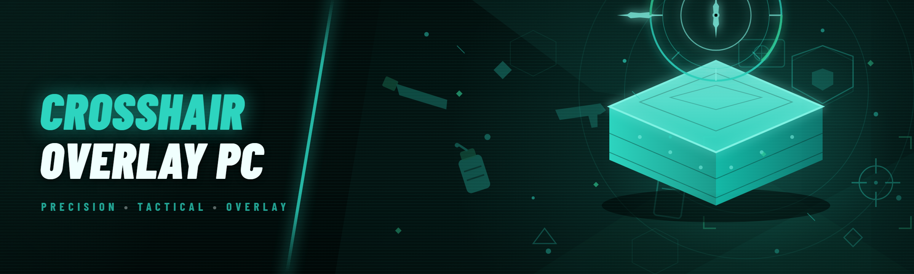

  
  
  

  

  
  
  

---

Custom crosshair overlay for PC games: PNG/SVG crosshair packs, hotkey toggle, per-game profiles, DPI-aware scaling, transparency and outline tuning.

## Overview

Custom crosshair overlay for PC games: PNG/SVG crosshair packs, hotkey toggle, per-game profiles, DPI-aware scaling, transparency and outline tuning.

  

## License

[MIT License](LICENSE)

  

